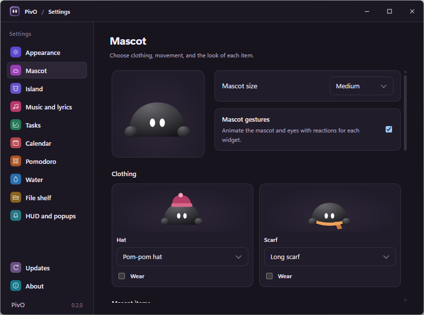
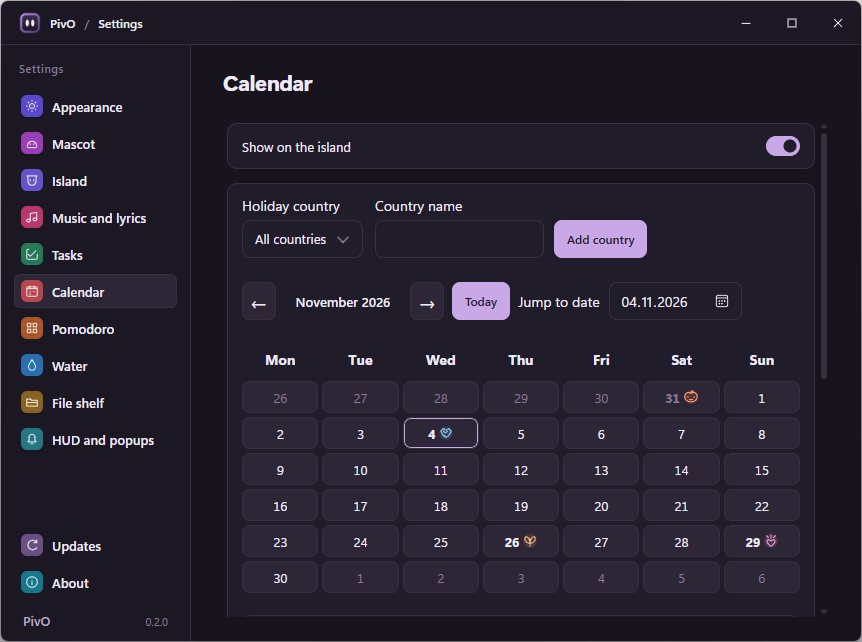

# PivO

A desktop companion that lives at the top of your screen, with its own mascot, music controls and everyday widgets.

[Download PivO 0.2.0 for Windows x64](https://github.com/RedGry/pivo/releases/download/v0.2.0/PivO_0.2.0_x64-setup.exe) · [What's new](https://github.com/RedGry/pivo/releases/tag/v0.2.0) · [Full changelog](CHANGELOG.md)

PivO starts as a compact pair of eyes or a thin Strip. Hover over its deliberate reveal target to open the island, use a widget, then move away to fold it. The companion stays on the selected monitor without reserving desktop space or taking keyboard focus during ordinary interaction. Settings opens as a separate window when requested.

## Screenshots

Actual PivO 0.2.0 Windows captures, taken through the separate PivO debug MCP. These images show the running application, rather than a mockup. The captures use English and Dark theme. The application supports English and Russian.

**Expanded island** — the mascot, clock and a built-in widget:


<details>
<summary>Compact Eyes and Strip</summary>

**Compact Eyes** — the companion at rest:


**Compact Strip** — the clock and compact eyes at the screen edge:


</details>

**Appearance settings** — themes, language and seasonal presentation:


<details>
<summary>Mascot customization and Calendar</summary>

**Mascot** — clothing previews, size and gesture controls:



**Calendar** — month navigation, holiday icons and country calendars:



</details>

Capture details and asset terms are recorded in [image provenance](docs/images/README.md).

## What's new in 0.2.0

The island now includes seven built-in widgets, a vector mascot with seasonal outfits, and a redesigned Settings window. Music gains Windows player controls and a dedicated lyrics view; personal widgets bring tasks, calendar events, water tracking and file shortcuts into the same panel.

| Widget | What it does |
| --- | --- |
| Music and lyrics | Shows the current Windows media session, artwork, playback controls and seeking. Displays synchronized or plain lyrics, with local import and configurable LRCLIB lookup. |
| Tasks | Keeps tasks, deadlines and completion state, with direct island actions, ordering and optional reminders. |
| Calendar | Shows month and week views, personal events, task dates and configurable holiday calendars. |
| Pomodoro | Keeps focus and break timers, configurable durations and the progress ring, including a running timer across restarts. |
| Water | Tracks daily intake, serving size and target, with undo, today's intake log and optional reminders. |
| File shelf | Keeps shortcuts to selected files, with open, reveal and remove actions. Removing a shortcut preserves the original file. |
| HUD and popups | Shows supported volume, brightness, input-language, keyboard, power and connectivity readings, with configurable notices. |

Navigate with the page indicators, previous/next controls or the mouse wheel over the expanded content. Choose which widgets are enabled in their Settings pages. See [widget behavior and Windows support](docs/PLUGINS.md) for provider requirements and limitations.

The mascot has size and motion controls, idle expressions, cursor gaze and holiday outfits. The interface supports Dark, Light and System themes, shared English/Russian localization, and a visual display selector. Panel motion is reversible and respects reduced-motion settings.

Read the [0.2.0 release notes](https://github.com/RedGry/pivo/releases/tag/v0.2.0) for the complete feature list. Actual validation results and remaining native-test limits are recorded in [VALIDATION.md](docs/VALIDATION.md).

## Install

1. Download [PivO_0.2.0_x64-setup.exe](https://github.com/RedGry/pivo/releases/download/v0.2.0/PivO_0.2.0_x64-setup.exe).
2. Run the installer. PivO installs for your Windows user.
3. Launch PivO and open Settings to choose a monitor, theme, language and widgets. Autostart is available in the tray.

Microsoft Edge WebView2 Runtime is required. The installer handles the normal runtime prerequisite. PivO is currently a Windows x64 prototype; other platforms are not included in this release.

The updater signature protects PivO updates. It is separate from Windows Authenticode signing, so Windows may still show a SmartScreen prompt for the installer.

## Update

Open **Settings → Updates → Check now**, then use the island's update action when a new version is offered. Automatic checks are optional; installing an update always requires a deliberate action. The tray also offers a manual update check.

Portable copies need a first installation with the setup executable before using installed updates. See [update setup and acceptance](docs/UPDATES.md) for signing and release details.

## Desktop behavior

- **Eyes** keeps the compact mascot visible. **Strip** tucks the capsule partly above the screen edge while retaining its compact row. **Expanded** reveals the current widget and controls.
- **Auto** chooses Eyes when the compact footprint is clear and Strip when an ordinary window overlaps it. Compact overrides are available in Settings.
- The current edge or eye target reveals the island. Returning through the old expanded body does not reopen it. Outside clicks fold it; interior clicks keep it open.
- Decorative areas pass pointer input through. The selected physical monitor anchors the panel without changing the desktop work area. A disconnected display choice is preserved and recovered on reconnect.
- **Ctrl+Alt+P** hides or restores the companion. Hidden and reduced-motion states stop unnecessary gestures.

## Build

PivO uses Tauri 2, Rust and TypeScript, without a frontend UI framework. Install Rust stable, Visual Studio Build Tools with C++ tools and the Windows SDK, Node.js 24 and Microsoft Edge WebView2 Runtime.

```powershell
npm --prefix windows/frontend ci
npm --prefix windows/frontend run build
cargo build -p pivo-windows --release --locked
```

The executable is written to `target/release/pivo.exe`. For frontend reload during development, run `npm --prefix windows/frontend run desktop:dev`.

Run the application validation with `pwsh -NoProfile -File scripts/validate.ps1`. For isolated interactive Windows testing, see [the test environment](docs/TEST-ENVIRONMENT.md). Native UI acceptance requires an interactive Windows desktop.

## Contribute

See [CONTRIBUTING.md](CONTRIBUTING.md), the [roadmap](docs/PLAN.md) and [architecture](docs/ARCHITECTURE.md). Active development uses `release/0.2.0`; changes reach protected `main` through reviewed pull requests and the required Windows CI check.

## License

Code is [MIT licensed](LICENSE). The mascot, artwork, sounds and branding have [separate terms](LICENSE-ASSETS.md); [asset provenance](assets/README.md) records their sources.

Dependency and Rust library notices are in [THIRD_PARTY_NOTICES.md](THIRD_PARTY_NOTICES.md).
