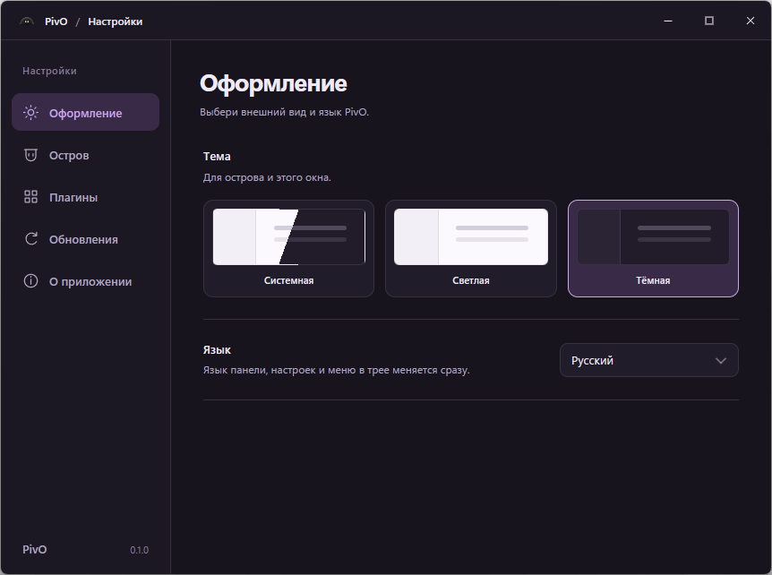

# PivO

A small companion at the top of your screen.

PivO is a desktop companion built with Tauri 2, Rust and TypeScript, with its own mascot and visual identity. Windows comes first; other platforms can follow.

[Download PivO v0.1.0 for Windows](https://github.com/RedGry/pivo/releases/download/v0.1.0/PivO_0.1.0_x64-setup.exe) · [Release notes](https://github.com/RedGry/pivo/releases/tag/v0.1.0)

<p align="center">
  
</p>

## Screenshots

Actual Windows application captures, shown in Russian. PivO also includes English.

**Expanded island** with the original mascot, clock and Pomodoro plugin:


**Compact Strip** keeps the desktop available:


**Settings** opens in a separate window:



Capture details and asset terms are recorded in [image provenance](docs/images/README.md).

## First milestone

An expandable top panel, our mascot and a clock. Music, a calendar, system stats and AI agent status can follow one step at a time.

**Status:** the compact interaction and plugin candidate includes a 560 x 160 island, finite character gestures, the simplified tray and declarative plugins. See [validation](docs/VALIDATION.md) for the final automated results and explicit runtime coverage limits.

## Build

Install Rust stable, Visual Studio Build Tools with C++ tools and the Windows SDK, Node.js 24 and the Microsoft Edge WebView2 Runtime.

```powershell
npm --prefix windows/frontend ci
npm --prefix windows/frontend run build
cargo build -p pivo-windows --release --locked
```

The executable is written to `target/release/pivo.exe`. For development with frontend reload, run `npm --prefix windows/frontend run desktop:dev`.

PivO has three presentations: **Strip**, a 24-pixel compact row for future status content; **Eyes**, the compact mascot; and **Expanded**, the full character and clock. Auto mode shows Eyes when the compact area is unobstructed and Strip when another ordinary window overlaps it. Settings can force either compact presentation.

Hover or click the deliberate edge target in Strip, or the eye cluster in Eyes, to expand. Move the pointer outside the expanded island to fold it after a short grace period. Outside clicks also fold it; interior clicks leave it open. Decorative areas pass clicks through without taking keyboard focus. The revealed header aligns the clock, settings and exit controls. Ctrl+Alt+P hides or restores the companion.

Settings groups **Appearance**, **Island**, **Plugins**, **Updates** and **About**. Choose Dark, Light or System theme, language, compact behavior and display. Dark preserves the original default appearance. Display selection follows the primary monitor by default; a missing saved display falls back to primary and resumes its saved placement when reconnected. Each language is a separate [locale file](locales/README.md), discovered on rebuild; English and Russian are included.

The approved static mascot at `assets/mascot.png` is bundled into the frontend. A portable build does not need a separate image file. See [asset provenance](assets/README.md) for its source and usage terms.

## Plugins

The first bundled plugin is Pomodoro, with Start/Pause and focus/break actions on the island and Reset in Settings. Settings shows connection tiles with developer-supplied icons and metadata, collapsed plugin settings, and JSON import without a rebuild. Island settings controls page order separately. See [the developer contract](docs/PLUGINS.md) and [examples](examples/plugins/). These declarative plugins cannot execute code or access files, processes or the network. Music, water tracking, a file shelf, tasks and device-event integrations remain separate future deliveries.

Compact Eyes blink, occasionally look curious and follow the cursor subtly. Strip briefly shows the original mascot every 120–180 seconds. Hidden and reduced-motion states stop those gestures. Reveal requires a 350 ms hover dwell; leaving Expanded starts a cancellable 200 ms fold delay.

Settings > Appearance includes an optional, persistent **Obsession** mode. The original mascot adds finite twig, smile, stare, wake, cursor-hug, clock-jealousy and folding gestures, plus a disappointed reaction when an unfinished timer changes modes. Enabled eyes become lilac hearts. Focus sessions, pauses and completions add a notebook, nervous patience and heart gifts; rare scenes include false sleep, a thread heart, visit counting, matching-time rings and a playful compatibility check. Turning it off immediately stops the mode and permits one short farewell. Expanded-only reactions wait briefly for a deliberate reveal. The mode is silent and respects hidden and reduced-motion states; see [design notes](docs/DESIGN.md) and [validation limits](docs/VALIDATION.md).

The tray offers Autostart, Settings, About PivO, Check for updates and Exit. Autostart applies to the current Windows user.

## Updates and installers

The Windows installer and signed updates use the official Tauri 2 updater. Update checks are available in Settings and the tray. The panel shows a friendly summary; technical error details stay in Settings. Automatic checks are opt-in, and installation always requires an explicit action. See [updates and release setup](docs/UPDATES.md) for signing keys, GitHub configuration, installer builds and the installed-version upgrade acceptance gate.

## Contribute

See [CONTRIBUTING.md](CONTRIBUTING.md), the [roadmap](docs/PLAN.md) and [architecture](docs/ARCHITECTURE.md). Keep the design simple, dependencies small and platform boundaries clear.

## License

Code is [MIT licensed](LICENSE). The mascot, artwork, sounds and branding have [separate terms](LICENSE-ASSETS.md).

Dependency and Rust library notices are in [THIRD_PARTY_NOTICES.md](THIRD_PARTY_NOTICES.md).

The header ring follows the selected plugin's real timer progress. Information plugins provide no progress and hide the ring. Clock/date formatting follows the selected locale.
